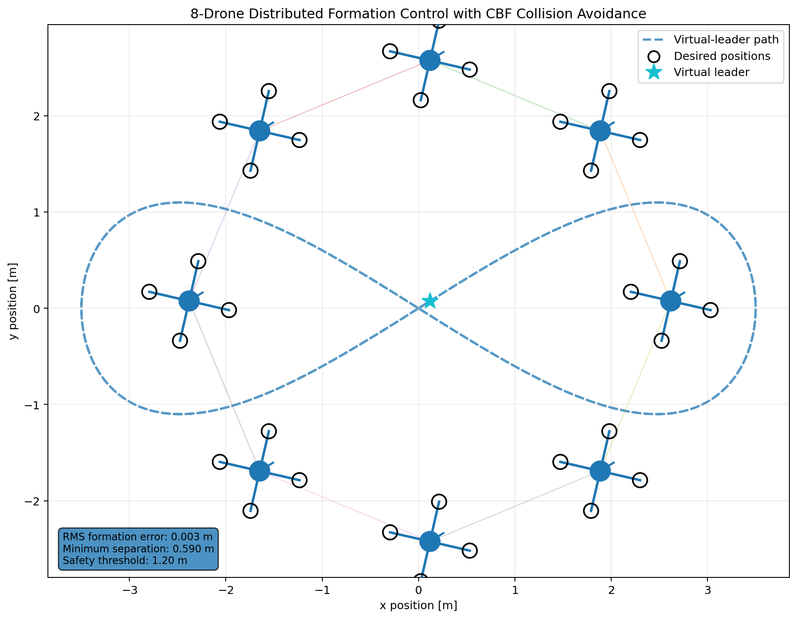

# Distributed Multi-UAV Formation Control & Collision Avoidance

**An 8-UAV swarm simulation using graph-based formation control and second-order Higher-Order Control Barrier Functions (HOCBF) for collision avoidance.**

<p align="center">
  
</p>

## Overview

This project implements an eight-agent UAV swarm simulation in Python, focusing on coordinated formation tracking and inter-agent collision avoidance.

A moving virtual leader follows a figure-eight trajectory while eight UAVs maintain a regular octagonal formation through a ring-based communication topology. A CBF-based Quadratic Programming (QP) safety filter modifies nominal acceleration commands when required to satisfy pairwise safety constraints.

## Key Features

- 8-UAV formation with a moving virtual leader.
- Ring communication topology using adjacency, degree and graph Laplacian matrices.
- Position and velocity feedback formation control.
- Second-order HOCBF-based collision avoidance.
- QP-based acceleration optimisation.
- Velocity and acceleration constraints.
- Live formation and separation metrics.
- Simulation animation and performance plots.

## Control Architecture

```text
Virtual Leader & Desired Formation
                |
                v
       Formation Controller
                |
                v
       Nominal Acceleration
                |
                v
         HOCBF Safety Filter
                |
                v
        Quadratic Programming
                |
                v
       UAV Motion Dynamics
                |
                v
        Updated Swarm States
```

## Safety Formulation

The pairwise safety function is:

\[
h_{ij}=\|p_i-p_j\|^2-d_s^2
\]

The implemented second-order HOCBF constraint is:

\[
\ddot h_{ij}
+(\alpha_1+\alpha_2)\dot h_{ij}
+\alpha_1\alpha_2h_{ij}\geq0
\]

A QP minimises deviation from nominal formation-control commands while enforcing the implemented safety constraints and acceleration bounds.

## Simulation Configuration

| Parameter | Value |
|---|---:|
| UAV agents | 8 |
| Formation | Regular octagon |
| Formation radius | 2.5 m |
| Safety distance | 1.20 m |
| Simulation duration | 36 s |
| Time step | 0.02 s |
| Maximum speed | 5 m/s |
| Maximum acceleration | 8 m/s² |

## Results

<badge color="success">Tested simulation scenario</badge>

| Metric | Result |
|---|---:|
| Minimum observed separation | 1.6075 m |
| Safety threshold | 1.20 m |
| Observed safety violations | 0 |
| Final RMS formation error | 0.003 m |
| Modified drone-time commands | 11.43% |

### Performance Analysis

| Formation tracking | Minimum separation | CBF interventions |
|---|---|---|
| `outputs/plots/formation_error.png` | `outputs/plots/minimum_separation.png` | `outputs/plots/cbf_interventions.png` |

## Technology Stack

- **Python 3.10+**
- NumPy
- SciPy
- Matplotlib
- FFmpeg

## Project Structure

```text
├── config.py
├── main.py
├── simulation.py
├── drones.py
├── dynamics.py
├── formation.py
├── controller.py
├── cbf.py
├── graph.py
├── metrics.py
├── visualization.py
├── collision_experiment.py
├── collision_speed_sweep.py
├── compare_experiments.py
├── requirements.txt
└── outputs/
    ├── swarm_result.png
    ├── swarm_animation.mp4
    ├── swarm_data.npz
    └── plots/
```

## Run Locally

```bash
git clone https://github.com/sorashree/Swarm-Drone-CBL-Safety-Simulation.git
cd Swarm-Drone-CBL-Safety-Simulation

python -m venv .venv
source .venv/bin/activate

pip install -r requirements.txt
python main.py
```

FFmpeg is required for MP4 animation generation.

## Limitations & Future Work

**Current limitations:** Simplified 2D UAV dynamics, fixed communication topology and simulation-only validation. HOCBF admissibility and safety guarantees require further analysis.

**Future development:**
- PX4 Software-in-the-Loop integration.
- 3D multi-UAV simulation.
- Communication delays and packet loss.
- Uncertain neighbour-state estimation.
- Robustness testing under disturbances and agent failures.

## Author

**Shreeya Mukherjee**

[GitHub](https://github.com/sorashree)

*Independent project in swarm robotics, distributed control and autonomous UAV systems.*

## Keywords

`Swarm Robotics` `Multi-UAV Systems` `Distributed Formation Control` `Collision Avoidance` `HOCBF` `Control Barrier Functions` `Quadratic Programming` `Python`
